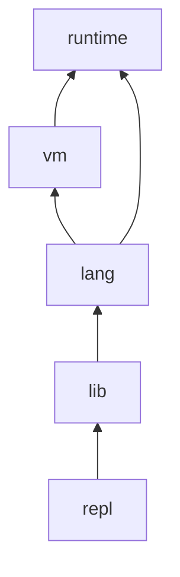

# Architecture

TinyLisp is one interpreter with one execution engine: a stack bytecode VM. Work flows through a fixed pipeline; the machine loop in `lang/eval.zig` schedules bytecode, native callbacks, and tail calls on explicit heap stacks.

## Pipeline

```
text
  → parser.zig          s-expressions (lists of values)
  → expand.zig          macros expanded (per top-level form)
  → compile.zig         typed AST (Node / Code)
  → vm/compiler.zig     Bytecode (+ scan.zig for slot names)
  → vm/exec.zig         run until call, return, or error
  → eval.run            frames on ks, values on vs
```

- **Top-level** — Each REPL line, file form, `load` form, and `eval` argument is read, expanded as a whole, compiled to a parameterless function in the root scope (`compiler.top`), then run once.
- **Functions** — On first call, the function's `Proto` is scanned for slot names, compiled to `Bytecode`, then executed. Recompilation happens when `Bytecode.stamp` ≠ `scope.epoch` (rebound primitives, inlined helpers, local shadowing of inlined names).

Macro expansion is the only place a **nested** machine runs: macro bodies execute via `eval.exec` while the expander walks the form. Running user code does not nest machines except for that and for FFI callbacks (which re-enter the same machine on `vs`).

## `src/` layout

| Unit | Role |
|---|---|
| `repl.zig` | CLI, REPL, root scope setup, loads `stdlib.lisp` |
| `runtime/` | Values, GC, scopes, typed AST nodes, machine stacks, primitives, continuations |
| `lang/` | Parser, expander, AST compiler, eval loop |
| `vm/` | Bytecode format, slot scan, code generator, executor |
| `lib/` | Natives (`map`, `load`, …), file loading, stdlib Lisp, FFI |

Each `.zig` file has one job. Imports follow layers (see `spec/repo_rules.py` and the diagram in `CLAUDE.md`): lower layers are shared; `repl.zig` sits at the top.

## Dependency direction (summary)



Documented exceptions (cycles on **data** only, not hidden behaviour):

- `runtime/` ↔ `vm/bytecode.zig` — `Proto`, `Frame`, `Go` hold bytecode pointers; `scope.bind` reads slot names from bytecode.
- `lang/expand` → `lang/eval`, `vm/compiler` — macros run Lisp and may compile expanded forms.
- `lang/eval` → `vm/` — `compiler.ready`, `exec.exec`; VM never imports eval.
- `lib/natives` → expand, compiler, parser — `load` / `eval` participate in the pipeline.
- `lib/ffi` → `lang/eval` — C callbacks run nested `eval.exec`.

Inside `runtime/`, `gc`, `value`, `scope`, `node`, and `machine` reference each other because allocation and root tracing touch all of them.

## The machine

`runtime/machine.zig` defines `Frame` kinds:

- **`.vm`** — Resume bytecode after a call.
- **`.loop`** — `each` / `map` bytecode loop (list position on `vs`, iteration scope in `iter_env`).
- **`.native`** — Natives with steps (`map`, `reduce`, `try`, `partial`, trampoline, `load`, …).

`eval.run` drives a `Go`: run VM code, deliver a value to the current frame, or apply a function. Tail calls replace the current `Go` instead of pushing (`tailcall` at top level; `.apply` in the VM).

Errors use Zig `error.Lisp` with the raised value in `value.errv`. `exec` uses `machine.recover` to unwind to the innermost `try` frame; otherwise the run clears stacks above its base.

## Tests and specs

- `spec/specs.lisp` — language and VM behaviour (`deftest` / `assert`).
- `spec/body-scope.lisp` — function-body `define` / unbound rules.
- `spec/repl.py` — REPL transcript tests.
- `spec/continuations.lisp`, `spec/ffi*.lisp`, `spec/uv-integration.lisp`, `spec/node.lisp` — focused areas.

See `CLAUDE.md` for the full file map and semantics that are not repeated here.